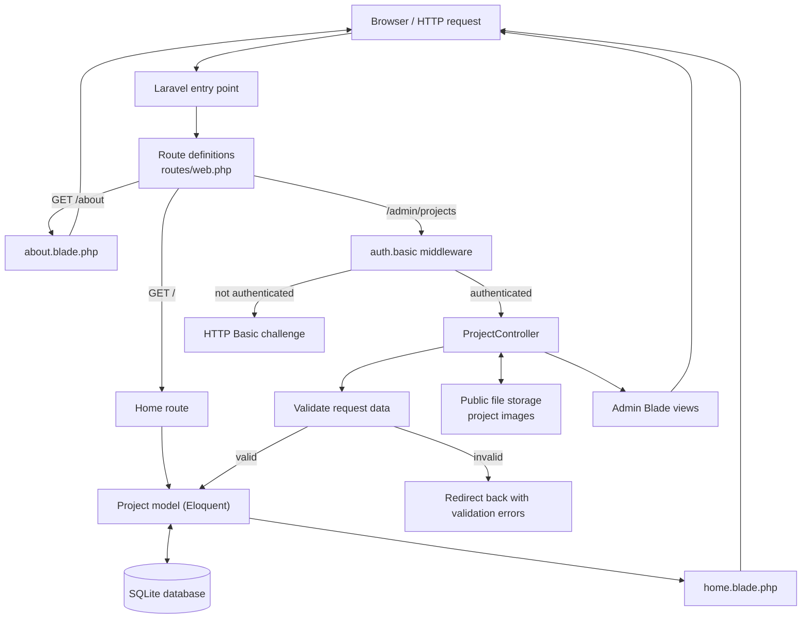

# Learning Laravel: Portfolio

This repository is my **Laravel learning project**: a small personal portfolio
that I use to understand how Laravel connects routes, controllers, models,
database records, uploaded files, and views into a working web application.

The Laravel application lives in [`portfolio/`](./portfolio/). Run the commands
below from that directory.

## What this project does

- Shows a home page with portfolio projects and an About page.
- Lets an administrator create, edit, and delete projects.
- Stores each project's title, description, optional image, GitHub URL, and
  live-site URL.
- Protects the admin project pages with HTTP Basic Authentication.
- Uses SQLite for local development and Pest feature tests for the project
  workflow.

## How a Laravel request works here

This diagram follows the main request path. The home page reads projects and
renders them; admin requests pass through authentication and use the controller
to validate and save changes before rendering a Blade page or redirecting.



In everyday terms, Laravel matches the URL and HTTP method to a route. The
route can run a small callback or send the request through middleware to a
controller. The controller handles the request, Eloquent works with the
database, and Blade turns the view data into HTML sent back to the browser.

## What I am learning

- **MVC and Laravel's folder conventions:** routes define entry points,
  controllers coordinate work, models represent data, and Blade views render
  pages.
- **Routes and resource routes:** named routes make links and redirects easier
  to maintain. A resource route can provide the standard create, store, index,
  edit, update, and destroy actions.
- **Middleware and route model binding:** the admin route group applies
  `auth.basic`, and Laravel can resolve a `{project}` route parameter to a
  `Project` model for controller actions.
- **Eloquent and migrations:** the `Project` model reads and writes project
  records, while a migration describes the `projects` table and its nullable
  fields.
- **Mass assignment:** the model's `#[Fillable(...)]` attribute lists which
  project fields may be populated from validated input.
- **Validation:** validate user input before saving it. In this app, project
  titles and descriptions are required, URLs must be valid, and uploaded images
  must be images no larger than 2 MB.
- **File storage:** uploaded images go to Laravel's `public` storage disk;
  database records keep the path, not the file contents.
- **Blade components and frontend assets:** a shared layout component keeps
  the page shell consistent, while Vite and Tailwind CSS build the frontend.
- **Feature tests:** Pest tests exercise routes and CRUD behavior, including
  validation, authentication, and image uploads.

## Things I learned to watch for

- A form's upload field is called `image`, while the database column is
  `image_path`. The uploaded file needs to be stored first; the resulting path
  is what belongs in the model. The raw upload field should not be passed to
  `Project::create()` or `update()`.
- Editing a project without uploading a replacement should keep its existing
  image. When replacing an image, save the new path and then remove the old
  file; deleting a project should also remove its image.
- Database and filesystem changes are separate concerns. Tests use
  `Storage::fake('public')` so they can check image behavior without writing
  real uploaded files.
- Validation and `$fillable` solve different problems: validation checks
  whether submitted values are acceptable, while `$fillable` limits which
  attributes can be mass-assigned.
- Named routes and Laravel's generated resource route names reduce hard-coded
  URLs, but the form method and route must still match the action being tested.
- To serve public-disk uploads locally, create Laravel's storage link with
  `php artisan storage:link`.

## Run it locally

Requirements: PHP 8.3 or later, Composer, and Node.js/npm.

```bash
cd portfolio
composer install
cp .env.example .env
php artisan key:generate
php artisan migrate
npm install
```

Start the Laravel server:

```bash
php artisan serve
```

In another terminal, from `portfolio/`, start Vite:

```bash
npm run dev
```

Open the local URL printed by `php artisan serve`. To create the symbolic link
needed for public project images, run `php artisan storage:link` once.

Run the test suite from `portfolio/`:

```bash
composer test
```

## Where to look in the code

- [`portfolio/routes/web.php`](./portfolio/routes/web.php) — public and admin
  routes.
- [`portfolio/app/Http/Controllers/Admin/ProjectController.php`](./portfolio/app/Http/Controllers/Admin/ProjectController.php) —
  project validation, CRUD, and image handling.
- [`portfolio/app/Models/Project.php`](./portfolio/app/Models/Project.php) —
  project model and mass-assignment fields.
- [`portfolio/database/migrations/2026_11_06_062353_create_projects_table.php`](./portfolio/database/migrations/2026_11_06_062353_create_projects_table.php) —
  project table structure.
- [`portfolio/resources/views/`](./portfolio/resources/views) — Blade pages and
  the shared layout.
- [`portfolio/tests/Feature/ProjectCrudTest.php`](./portfolio/tests/Feature/ProjectCrudTest.php) —
  tests for the admin project workflow.

